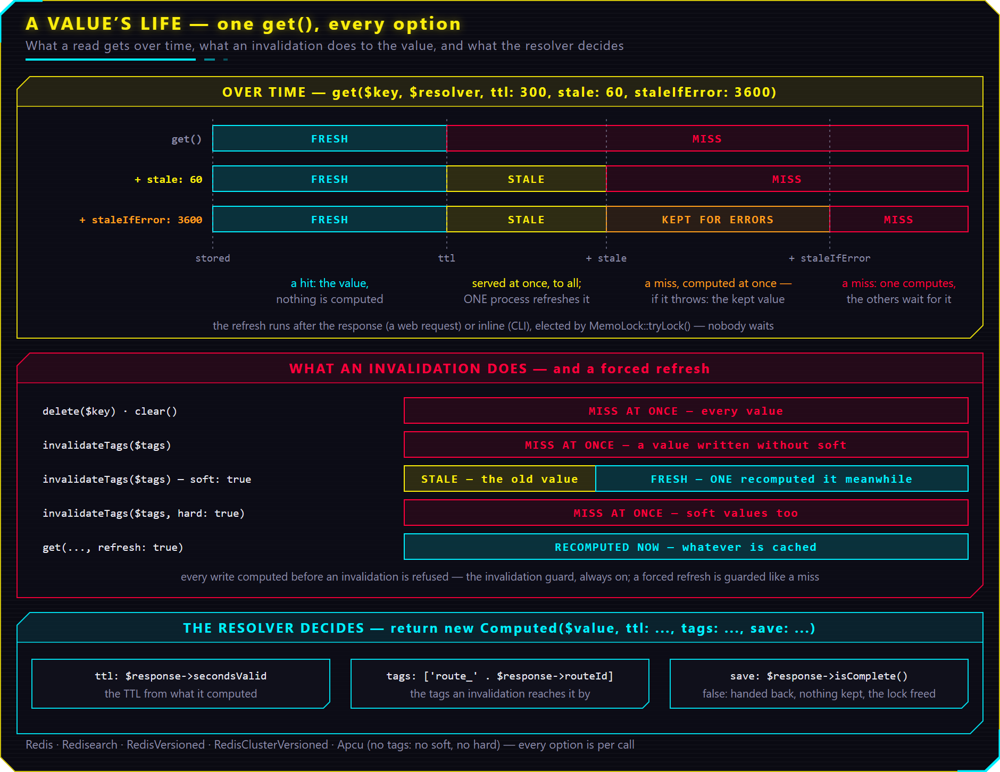
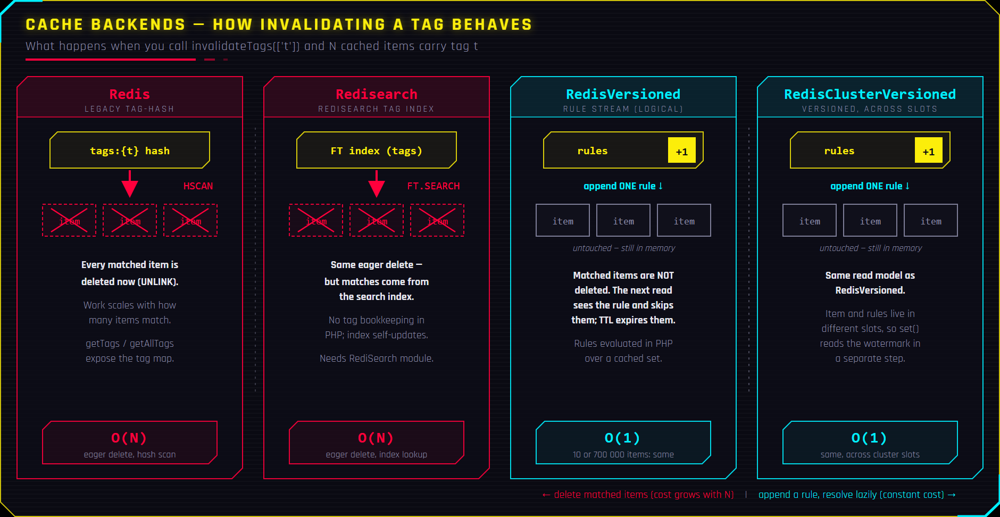
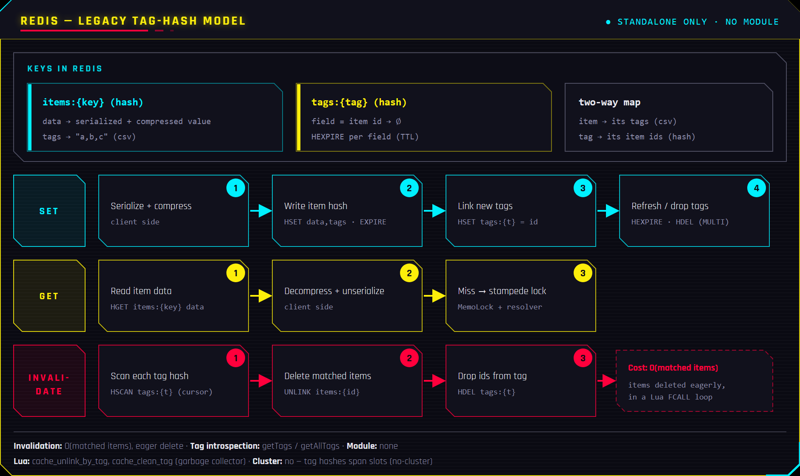
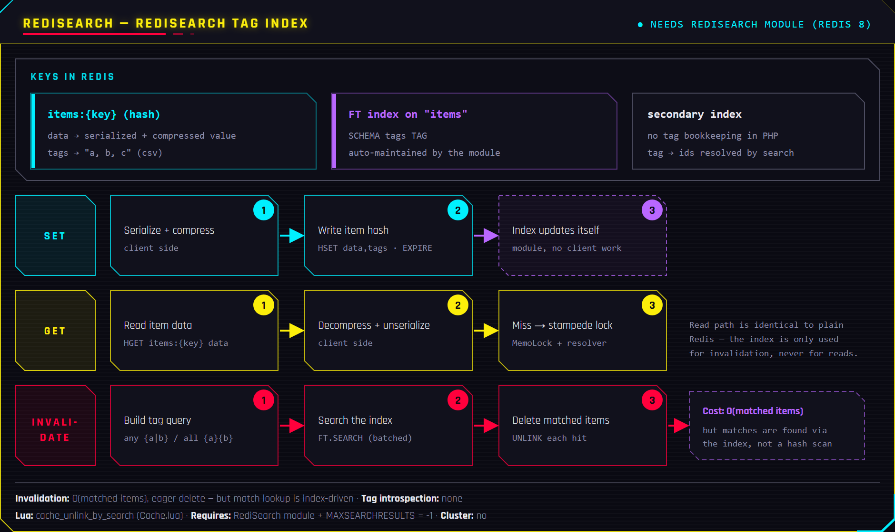
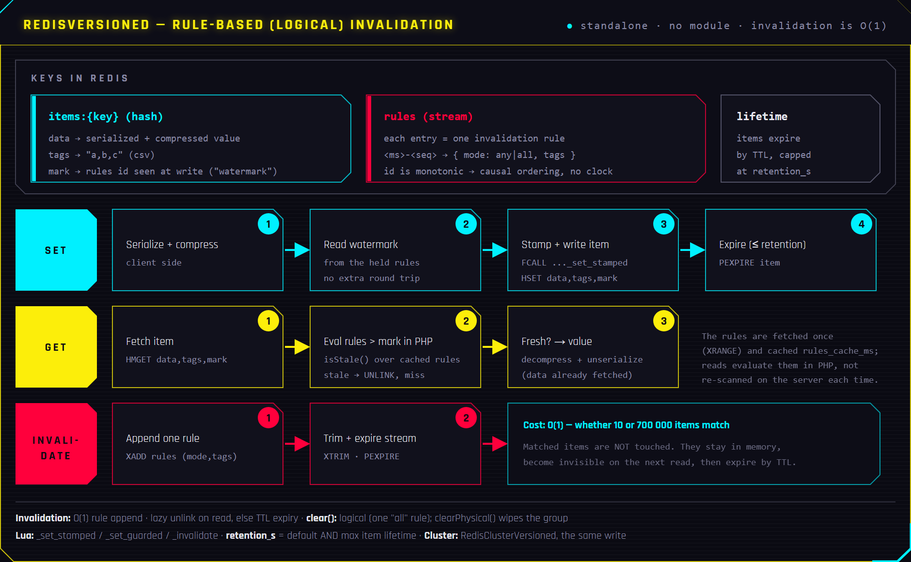
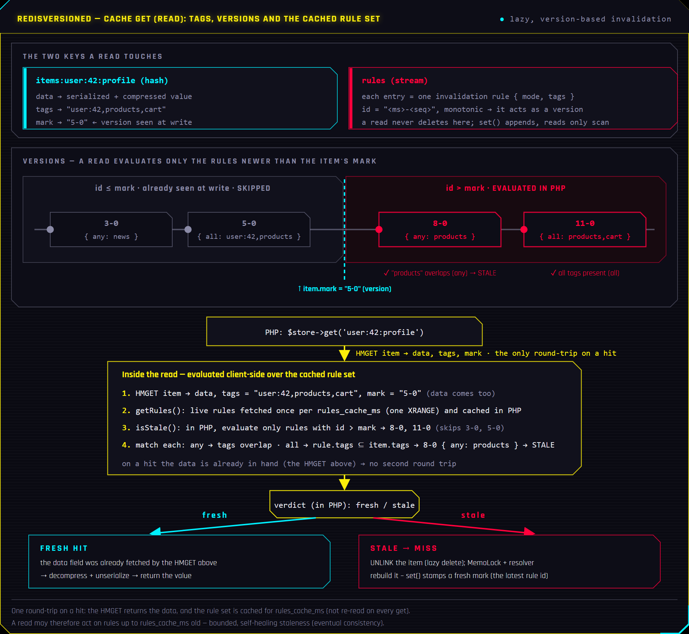
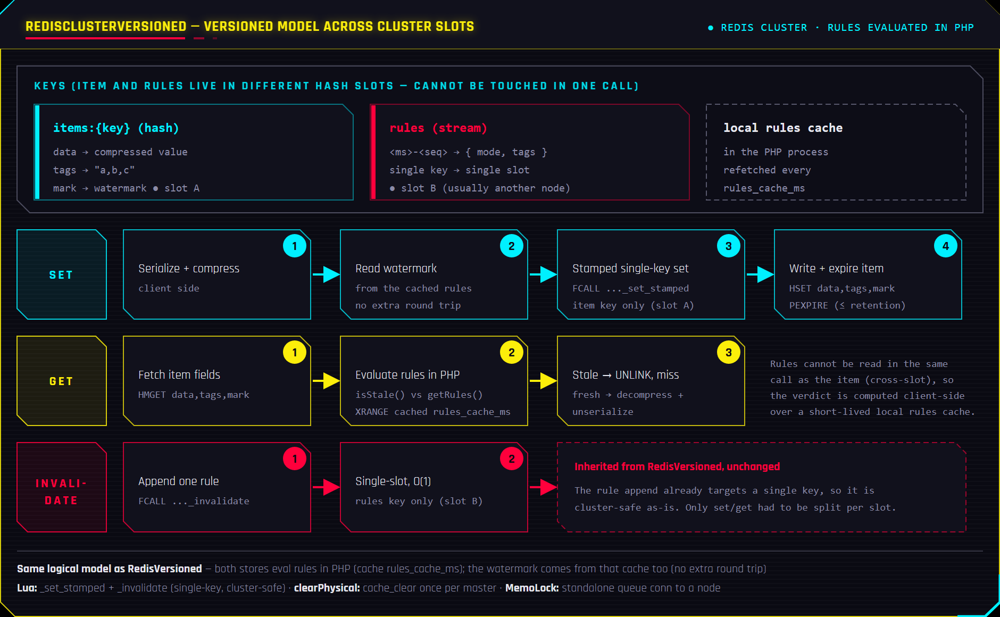
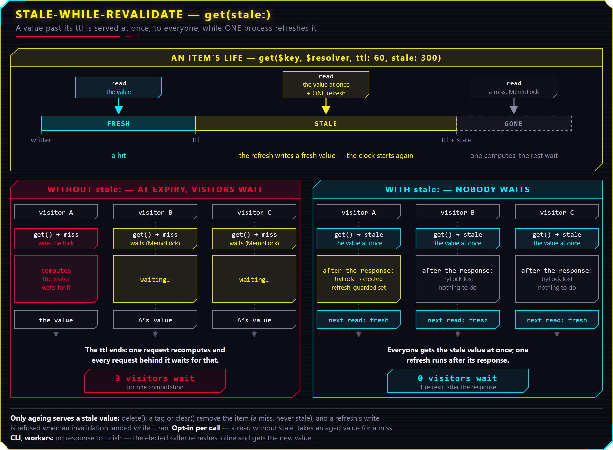
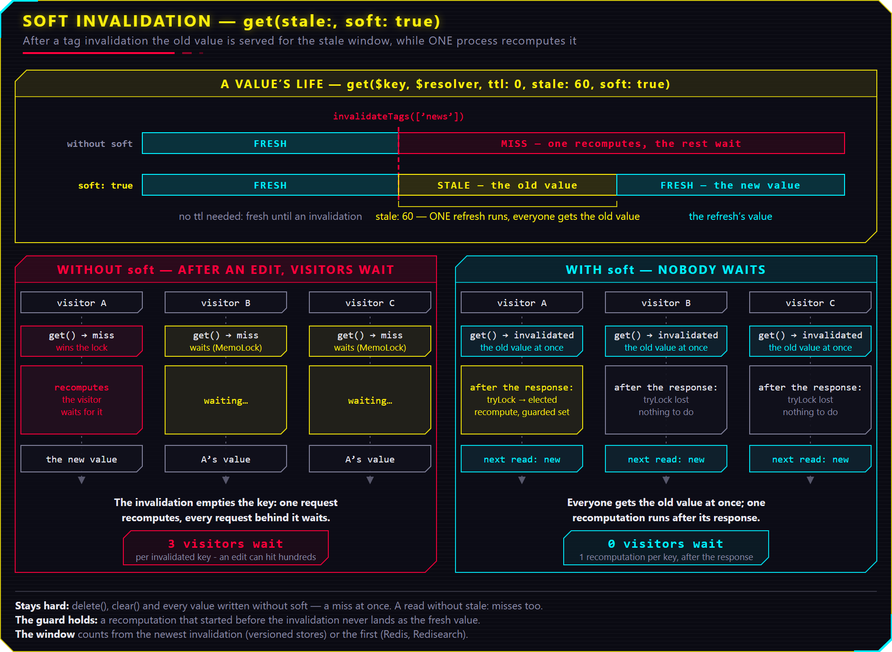
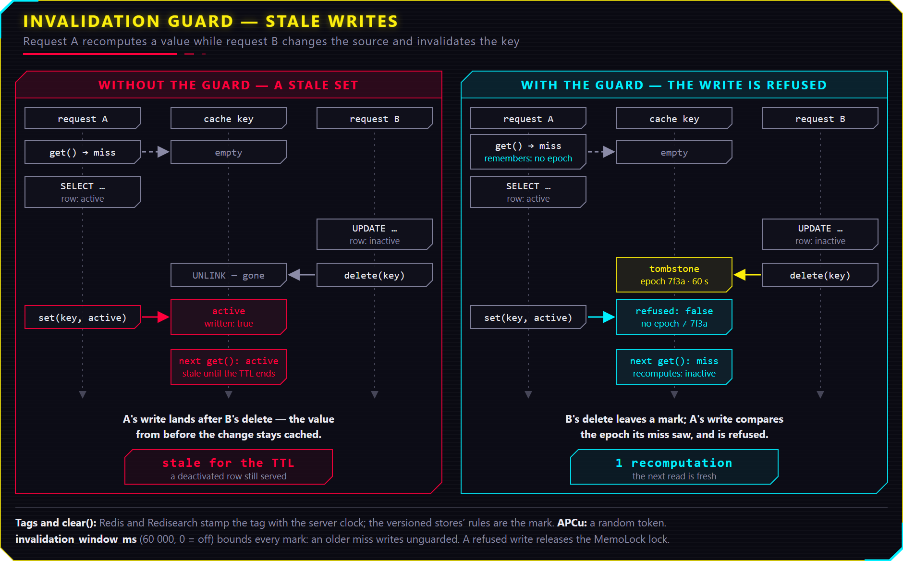

# Cache Stores (APCu, Redis, Redisearch, RedisVersioned, RedisClusterVersioned)

This library provides a two-tier cache system designed to minimize database load
and speed up response times. **Every store query that returns the same data for
the same input should be cached.** Database queries are expensive - cache is not.

See also: [README.MEMOLOCK.md](README.MEMOLOCK.md) for stampede protection.

## Why cache matters

A typical page load may trigger 10-30 database queries. Many of these return
the same data on every request (e.g., job categories, competences, navigation
menus). Caching these results means:

- **Faster responses** - APCu reads take microseconds, Redis reads take ~1ms
- **Lower database load** - fewer queries = more capacity for writes and complex operations
- **Better scalability** - cache handles traffic spikes that would overwhelm the database

**Rule of thumb:** If data doesn't change on every request, cache it.

## The two tiers

| Tier | Backend | Shared? | Speed | Survives restart? | Tags? |
|------|---------|---------|-------|-------------------|-------|
| **Perishable** | APCu | No (per-worker) | Fastest (~1μs) | No | No |
| **Persistent** | Redis / Redisearch / RedisVersioned / RedisClusterVersioned | Yes (all workers/servers) | Fast (~1ms) | Yes | Yes |

**Use perishable (APCu)** for data that is read frequently and changes rarely
within a single request cycle - like lookup tables, categories, and reference data.

**Use persistent (Redis)** for data that must be shared across workers or servers,
or when you need tag-based invalidation.

## Accessing the cache

Access stores via the cache service so they are created with the correct config
and connections:

```php
use Ovos\Service\Cache;

$cacheService = $this->container->get(Cache::SYMBOL);

// Get specific tier
$perishable = $cacheService->getPerishable()->getStore();  // APCu
$persistent = $cacheService->getPersistent()->getStore();   // Redis/Redisearch

// Shorthand (persistent by default)
$store = $cacheService->getStore();                         // Redis/Redisearch
$store = $cacheService->getStore(persistent: false);        // APCu
```

Redis stores keep the main and queue connections supplied to their constructor.
Create another store to use different connections; `setConnection()` and
`setQueueConnection()` have been removed.

Changing a versioned store's group with `setGroup()` discards its local rule state.
Each group keeps its own shared rules in APCu.

## One call, and which option for which problem

The call worth knowing is `get()` with a resolver. It reads the value; on a
miss it runs the resolver, stores what it returns and hands it back. While one
process computes, the others wait for its result (MemoLock, see
[Stampede protection](#stampede-protection-memolock)), and a write computed
before a `delete()` or `invalidateTags()` never lands after it (see
[Invalidation guard](#invalidation-guard-stale-writes)). None of this needs
configuring:

```php
$categories = $store->get('categories', fn() => $this->loadCategories(), ttl: 3600, tags: ['categories']);

// when a category changes
$store->invalidateTags(['categories']);
```

| You want… | Pass | What happens | See |
|---|---|---|---|
| no stampede: one computation per miss, not one per request | nothing — `get()` with a resolver | one process computes while the others wait for its result (MemoLock), across every server; `queue: false` skips the lock (a read that never computes) | Stampede protection |
| nobody to wait when a value expires | `stale: 60` | past its TTL the old value is served for 60 s while **one** process refreshes it, after the response | Pattern 5 |
| nobody to wait after an edit either | `stale: 60, soft: true` | a tag invalidation ages the value instead of removing it: served for 60 s while one process recomputes it | Soft invalidation |
| the last good value through an outage | `staleIfError: 3600` | kept 1 h past its stale time — a miss then, but when the computation throws, it is returned | Stale-if-error |
| the TTL or the tags from the computed value | the resolver returns `new Computed($value, ttl: ..., tags: ...)` | the Computed's TTL and tags are what is stored | Pattern 3 |
| not to keep an incomplete value | the resolver returns `new Computed($value, save: false)` | the value is handed back, nothing is stored, the lock is freed at once | Pattern 3 |
| a new value now (a warm-up, a "refresh" button) | `refresh: true` | recomputed and stored, whatever is cached | Forced refresh |
| an edit to show at once, soft values too | `invalidateTags(..., hard: true)` | a miss at once, also for a value written with `soft: true` | Via tags |
| a value gone for sure | `delete()`, `clear()` | always a miss at once — nothing is ever served stale after them | |

The options are per call: a `get()` that does not pass them behaves as it
always did. APCu has no tags, so `soft:` and `hard:` mean nothing there.



Over time a value is fresh for its TTL (a hit), then stale for `stale:` (served
at once while one process refreshes it), then kept for errors for
`staleIfError:` (a miss, computed at once - a computation that throws gets the
kept value), then gone. `delete()` and `clear()` end it at once; so does a tag
invalidation, unless the value was written with `soft: true` - then it is
stale for its `stale:` window, and `hard: true` overrules that.

## Store differences

The four persistent stores split into two families by **what `invalidateTags()`
actually does**. The tag-hash (`Redis`) and RediSearch (`Redisearch`) stores
**delete the matched items eagerly**, so the work grows with the number of
matches. The versioned stores (`RedisVersioned`, `RedisClusterVersioned`) **append a
single invalidation rule** and let reads resolve staleness lazily, so the cost
is constant no matter how many items match.



### APCu (`Ovos\Cache\Store\Apcu`)
- In-process memory cache (per PHP worker).
- Fastest option, but not shared across servers or processes.
- No tags support.
- Best for: lookup tables, reference data, anything read-heavy that changes rarely.

### Redis (`Ovos\Cache\Store\Redis`)
- Distributed cache shared across workers/servers.
- Supports tags with `getTags()`, `invalidateTags()`, and `getAllTags()`.
- A write links the item into each of its tags whose index field is missing
  (`HEXISTS` on the tag hash, not the item's own tag list), so a field
  evicted or deleted by hand is back with the item's next write.
- Uses Redis Pub/Sub for MemoLock queueing (needs a separate queue connection).
- Best for: shared state, session-adjacent data, anything needing tag invalidation.



### Redisearch (`Ovos\Cache\Store\Redisearch`)
- Distributed cache with tag invalidation powered by RediSearch.
- Uses a RediSearch TAG index for fast tag-based invalidation.
- Requires the RediSearch module (bundled in Redis 8); the invalidation's
  cursor is bounded by `MAXAGGREGATERESULTS`, which must stay unlimited
  (its default).
- Supports tags in `set()` and `invalidateTags()`, but does not expose
  `getTags()` or `getAllTags()`.
- `invalidateTags()` reads the matches through a cursor (`FT.AGGREGATE …
  WITHCURSOR`), 2500 per page (store option `invalidate_page`), and removes
  each page in calls of 1000 items before it reads the next: no single
  command holds the server for every match. An item is served until its
  page is removed, as in the tag-hash store's batches of 7500; a value
  computed before the invalidation is refused from the start (the stamps
  come first). A soft value's mark re-indexes its item, so the cursor
  delivers it once more; that delivery finds the invalidation's own token
  and leaves it as it is. A value written through after the stamps (no
  miss of its own) is re-indexed the same way and can be removed by the
  walk: an over-invalidation, safe (the next read recomputes), as in the
  tag-hash store's walk.
- Best for: projects with many tagged cache entries where invalidation speed matters.



### RedisVersioned (`Ovos\Cache\Store\RedisVersioned`)
- Distributed cache with **rule based (logical) tag invalidation**:
  `invalidateTags()` appends one rule to a stream instead of deleting the
  matched items - **O(1) whether 10 or 700000 items match**. Reads fetch the
  item in one `HMGET` and evaluate it in PHP against a held rule set - the
  newest rule per tag, refreshed at most once per `rules_cache_ms` by fetching
  only what was appended since; stale items are lazily unlinked and
  physically expire by their TTL.
- The rule set is **shared by the workers of a server through APCu**
  (`rules_shared_cache`, on wherever APCu is enabled): a fresh process - every
  request, under PHP-FPM - adopts it instead of loading the whole stream.
- **The rule set while it reloads.** Each worker checks a read against its
  copy of the rule set, and one worker reloads that copy for the server about
  once per `rules_cache_ms`. A read takes the first of five cases that applies:
  1. **A young copy** - fetched less than `rules_cache_ms` ago, and holding
     every invalidation made on this server - checks the read, with no round
     trip. Exact reads (`rules_cache_ms: 0`) never take this case.
  2. **An outage, or a reload hanging past a second.** The last attempt to
     read the stream failed, or another worker's reload has run for more than
     `RedisVersioned::SLOW_RELOAD_MS` (1 s): the copy checks the read whatever
     its age. With no copy every item is a miss, computed for the caller
     without the stampede lock and not stored. One worker tries the stream
     again once the flag is free and `RedisVersioned::RETRY_MS` (1 s) has
     passed since the last attempt *ended*.
  3. **The flag is free.** This worker takes it, reloads the copy - one
     `XRANGE` from its last id - and shares the result; a failed reload starts
     an outage.
  4. **Another worker reloads, for no more than a second.** A copy no more
     than `rules_cache_ms` + 1 s old, holding this server's invalidations,
     checks the read - exact reads too.
  5. **Anything else** (an older copy, one that may lack an invalidation
     made on this server, none at all): every item is a miss, computed
     without the stampede lock - a worker waiting for the lock would read a
     miss as well. With a copy the value is stored with the copy's last rule
     id, which only makes it outdated sooner; with none, nothing is stored.

  An example. `rules_cache_ms` is 1 s, and another server invalidates
  `product:7` at 12:00:00.000. A worker here whose copy was fetched at
  11:59:59.600 serves `product:7` until 12:00:00.600 (case 1). The first read
  after that takes the flag and reloads (case 3); a millisecond later the
  copy holds the rule, and every worker of the server adopts it. A worker
  reading during that millisecond uses its copy (case 4: less than 2 s old);
  one whose copy is older - the first request after an idle spell - misses
  and computes (case 5), but never waits. Had the reload hung on a dead
  node, the other workers would have gone on using their copies after a
  second (case 2): only the reloader waits, and a node that stays down costs
  the server one attempt a second.

  The mechanism. The copy, the flag, the record of the last attempt and the
  record of the newest invalidation made here live in APCu, beside each
  other; the processes sharing one APCu are one server. The flag is a lease:
  the moment the reload began and a nonce, taken with
  `apcu_add()`/`apcu_cas()` and released only by its owner. It is free
  again after `SharedRules::LEASE_MS` (30 s) - for a worker that died
  without letting go; a reloader that dies of a fatal error lets go of it as
  its process shuts down. A failure reported by an attempt that began before
  the last success is ignored. A reload that finds the stream started over
  (lost, then appended to again) replaces the shared copy whatever its ids.
  The flag and the note of the newest invalidation made on this server (its
  time and rule id) are written with no expiry: they change only through
  `apcu_cas()`, which keeps the expiry an entry was created with. Where APCu
  refuses to record the flag (it does not with the default settings: a full
  APCu empties itself instead), the worker loads the rules on its own - one
  fetch per request while it lasts - shares nothing, and logs one warning;
  where it takes the flag but refuses the copy, it logs one warning too (a
  newer copy already there is no refusal). A write stores the last rule id
  of the copy its read was checked against; a write with no read before it
  (a write-through) takes its copy through the same five cases and stores
  that copy's last id - the stream's newest id is never read for a write.
  With no copy it is not stored (see *Invalidation guard*). Case 5 costs
  computations, not waits: a cold server (no copy) at 300 requests a second,
  20 cache reads each and a reload of 0.3 s computes about 1 800 values it
  does not store.
- **An invalidation made on this server.** The process that invalidates
  usually holds a copy that ends right before its own rule - the reply of the
  append names the id it followed. Then the rule goes into that copy, which
  counts as fetched right before the invalidation call (everything appended
  until then is in it), and the first invalidation of a store instance
  shares the copy at once, before it records the invalidation for the
  server: every other worker adopts it on its next read as a fresh copy,
  with no fetch and no miss. Later invalidations of the same instance share
  it once more, when the instance goes away (the end of the request), never
  at a read: a loop of 10 000 single-tag invalidations copies the set twice,
  not 10 000 times. Until then the other workers lack those later rules and
  reload through the flag. When another rule was added in between, the copy
  would skip it: nothing goes into it, the invalidating process lacks its
  own rule like the others, and its copy keeps its old fetch time. The
  record of the invalidation - the time taken once the append returned, to
  the microsecond, and the rule id - keeps every copy fetched before it and
  ending before the rule from checking a read: a copy fetched a fraction of a
  millisecond later is trusted. Each of the two is raised in one APCu step and
  never lowered, so two invalidations racing on one server always leave the
  later one's.
- **What it promises.** While Redis answers and reloads finish within a
  second, an invalidation made on another server is seen within
  `rules_cache_ms` + 1 s. While the rules can be read, an invalidation made
  on this server is never served stale here. During an outage, or a reload
  hanging past a second, invalidations made elsewhere are seen when the
  stream answers again, and no request but one per server per second fetches
  the rules. No value computed after a read without rules, or without its
  epoch, is stored. **Keep the read timeout and the connect timeout of the
  cache's Redis connection short**, well under a second for a node that
  answers in milliseconds: a hanging node then stalls only the request that
  reloads, and only for that long. Switched off (`rules_shared_cache: no`),
  each process works alone: it loads the rules of the whole retention window
  once, before its first hit.
- The set is **bounded** (`rules_max_tags`, default 15 000; 0: no bound): a
  request copies it out of APCu, about 0.16 ms and 0.45 KB per thousand rules,
  and what grows it is the number of *distinct* tags invalidated within the
  retention - not how often one tag is. Past the bound it keeps its newest
  90 % and puts a floor in place of the rest, as a clear at the newest rule
  it dropped: an item written with a rule id before the floor is a miss
  (recomputed once, never served stale), one written after it is checked as
  before. Size it so the floor stays older than the longest TTL in the
  group - a per-customer tag invalidated on every login moves it by one rule
  per customer. A load from the beginning reads the stream 10 000 entries at
  a time.
- `clear()` is logical as well (one rule matching everything);
  `clearPhysical()` wipes the whole group for maintenance.
- `rules_retention_s` (default 30 days) is the default **and maximum** item
  lifetime: a ttl of 0 means "as long as the store allows", a ttl above the
  retention is capped to it (and logged).
- The rules stream carries no TTL, so a `volatile-*` (or `noeviction`)
  eviction policy never evicts it - run one of those. Should it be lost anyway
  (`allkeys-*`, a `DEL`, a slot gone with a cluster node), the read path fails
  safe: an item written with a rule id the stream no longer holds is a miss,
  never a stale hit, at the price of recomputing the group once.
- Does not expose `getTags()` or `getAllTags()`; no RediSearch module needed.
- Best for: projects with very large tag invalidations, where deleting the
  matched items at invalidation time is too expensive.



A closer look at the read path - how a `get()` fetches the item in one
`HMGET` and uses its `mark` (the rule id it was written with) to evaluate,
in PHP against the held rule set - the newest rule per tag, shared by the
server's workers through APCu and refreshed incrementally at most once per
`rules_cache_ms` - only the invalidation rules it has not seen yet
(id > mark), matches them against the item's tags, and serves a fresh hit or
lazily unlinks a stale item:



### RedisClusterVersioned (`Ovos\Cache\Store\RedisClusterVersioned`)
- The RedisVersioned store on a **Redis Cluster**: same data model and
  semantics; reads evaluate the invalidation rules on the PHP side against
  the same held, shared rule set (`rules_cache_ms`, `rules_shared_cache`),
  and writes take their rule id from it, as on a standalone server.
- Requires a `redis_cluster` connection (a `seeds` list) plus a standalone
  queue connection **pointed at a node of the same cluster** for MemoLock
  pub/sub (see the configuration reference below).
- No RediSearch module required on the cluster nodes.



### Cost at a glance

Theoretical per-operation cost, where **N** = items carrying the invalidated
tag and **T** = tags on the item being written or read:

| Backend | `get()` hit | `set()` | `invalidateTags()` | `clear()` |
|---------|-------------|---------|--------------------|-----------|
| **APCu** | O(1) | O(1) | &mdash; *(no tags)* | O(n) |
| **Redis** (tag-hash) | O(1) | O(T) | **O(N)** | O(n) |
| **Redisearch** | O(1) | O(1) ‡ | **O(N)** ‡ | O(n) |
| **RedisVersioned** | O(T) § | O(1) | **O(1)** | **O(1)** |
| **RedisClusterVersioned** | O(T) § | O(1) | **O(1)** | **O(1)** † |

§ One `HMGET`, then the item's tags looked up in the held rule set (the
newest rule per tag), plus the `all`-matching rules newer than the item, which
are few; the rule set itself is refreshed at most once per `rules_cache_ms`
and shared by the server's workers, so its size and the length of the
invalidation backlog do not enter a read.

‡ RediSearch maintains the tag index itself: `set()` is a single write (no
per-tag bookkeeping like the tag-hash store's O(T)), and `invalidateTags()`
finds the N matches through the index instead of scanning a tag hash &mdash; the
same O(N) eager delete, with a smaller constant, spread over ⌈N/2500⌉ cursor
reads and ⌈N/1000⌉ removal calls, so other clients run in between.
† `clear()` is O(1) logically (one rule); `clearPhysical()` is O(number of masters).

- **Invalidation is the real fork.** Redis and Redisearch delete every matched
  item when you invalidate, so the call is O(N) &mdash; instant for a handful of
  items, a latency spike when a tag fans out to thousands. The versioned stores
  append one rule and return in O(1) no matter how many items match; staleness is
  resolved later, lazily, on read.
- **Versioned reads do not see the backlog.** The held set keeps only the
  newest rule per tag, so a read costs the item's tag count however many rules
  were appended since it was stamped; rules age out by `rules_retention_s`, and
  a clear subsumes everything older than itself. What a fresh process used to
  pay - loading the whole stream before its first hit - is what the shared set
  removes.
- **Round trips, not big-O, set the floor.** Each persistent op above is one
  server round trip (Lua / pipeline); the versioned read refreshes its rule set
  at most once per `rules_cache_ms`, incrementally, and shares it with the
  other workers of the server through APCu, so a fresh process starts from the
  shared set rather than from the whole stream. A miss with a resolver costs
  three on every Redis store: the read, the lock with its second look (`SET NX`
  and the `HMGET`, the tag-index stores' `TIME` for the miss's stamp with them)
  and the write with the lock's release (both `FCALL`s), each step pipelined -
  five on a cluster, where the lock and the item are of different slots. A
  round trip is ~0.1-1 ms on a LAN; an in-process APCu hit is ~1 µs
  &mdash; big-O only starts to bite once N or R is large.

Bottom line: reads are O(1)-ish on every backend, so the choice comes down to
**invalidation** &mdash; pick a versioned store when tags match many items or you
invalidate often; the tag-hash / RediSearch stores are fine when invalidations
are rare and always small, or when you need `getTags()`/`getAllTags()` (only the
tag-hash `Redis` store exposes them).

### Measured

One local run of `php cli.php benchmarks run` (loopback Redis, single machine).
Absolute seconds depend on the benchmark's iteration constants, so read them as
**cross-store ratios**, not wall-clock truth; on loopback the round trips are
near-free, so these mostly expose CPU/algorithmic cost. Time in seconds, lower
is faster.

*This run predates the compacted, shared rule set (September 2026): the
backlog column below shows the old per-read walk over every unseen rule, which
the compaction removes, and the two FPM rows the matrix has since gained -
`readHitsFreshInstanceAfterLargeBacklog` and its `NoSharedRules` twin, a store
re-created every `FRESH_INSTANCE_EVERY` reads - are not in it yet. A re-run is
pending; until then the table stands as the record of the eager-versus-lazy
comparison it was made for.*

| Backend | `readHits` | `readHits` + large backlog | `invalidateMatchingAll` | `invalidateRepeated` | `writeOverwrite` | `churn` |
|---------|-----------|----------------------------|--------------------------|----------------------|------------------|---------|
| **Redis** (tag-hash) | 3.06 | 4.10 | 0.0254 | 0.94 | 6.08 | 3.66 |
| **Redisearch** | 3.24 | 3.88 | 0.0397 | 0.73 | 3.24 | 2.76 |
| **RedisVersioned** | 3.19 | 4.72 | **0.0005** | **0.38** | 3.62 | 2.98 |
| **RedisClusterVersioned** | 4.66 | 6.80 | **0.0006** | 0.53 | 4.96 | 4.16 |

What the run confirms:

- **O(1) vs O(N) invalidation is the headline.** A versioned `invalidateTags()`
  lands in ~0.5 ms versus ~25 ms (Redis) and ~40 ms (Redisearch) &mdash; about
  **50× and 80× faster**, and the gap widens with the match count.
- **`set()`'s O(T) shows up.** The tag-hash store's `writeOverwrite` (6.08 s) is
  ~1.7-1.9× the single-write stores (3.2-3.6 s): that is the per-tag
  `HSET`/`HEXPIRE` bookkeeping. Redisearch and the versioned stores write once and
  pay nothing per tag.
- **Reads were flat until the backlog grew - and that is what changed.**
  Steady `readHits` are within ~6 % across Redis, Redisearch and RedisVersioned
  (3.1-3.2 s). After a large invalidation backlog the versioned read climbed to
  4.72 s (~20 % over Redisearch) because every unseen rule was walked on every
  read and the whole backlog was held client-side (~460 KB). The held set is
  now the newest rule per tag, so a read looks its tags up instead of walking
  the backlog; the re-run should bring that column back to the flat line.
- **`churn` (wide fan-out, sparse re-reads) separates them.** When each round
  invalidates a wide slice but only a hot subset is re-read, the tag-hash Redis is
  slowest (3.66 s) &mdash; it eagerly deletes the whole slice every round and pays
  O(T) per rebuild &mdash; while Redisearch (2.76 s) and RedisVersioned (2.98 s)
  stay close. The versioned store beats the legacy tag-hash by ~20 %; Redisearch
  edges it here because its reads are flat (no rule eval) and an indexed delete is
  still cheap at this fan-out. Widen the fan-out further, or count the
  invalidation-call latency rather than throughput, and the versioned O(1) pulls
  ahead.
- **Cluster overhead is the client, not the algorithm.** RedisClusterVersioned
  trails the standalone versioned by ~1.4-1.6× across the board (`churn` 4.16 vs
  2.98 s), matching the raw cluster-client cost (`Connection\RedisCluster`: 1.41 s
  cluster vs 0.92 s standalone). Invalidation is still O(1) (~0.6 ms) on the
  cluster.

(APCu is a different tier &mdash; in-process, no tags &mdash; so it is not part
of this persistent-store run.)

#### Bans

A large ban, measured on its own: items filled in each store's own layout
(64-byte values, one tag each), the ban sent through `invalidateTags()` in
chunks of 50 tags while a second process `PING`s the server and records every
latency. Redis 8.8 in Docker Desktop on Windows, PHP 8.5, phpredis 6.3; a
range is two or three runs, a single figure one run. The Symfony rows are
bastnic's figures for the same shape on a standalone Valkey.

| Store | 1 000 tags × 1 000 items | 5 000 × 200 | Server work (1 000 × 1 000) | PING p50 / p99 / max, 1 000 × 1 000 | PING p50 / p99 / max, 5 000 × 200 | Memory after |
|-------|---:|---:|------|---:|---:|------|
| **Redis** (tag-hash) | 3.5 s | 5.9 s | 1 020 `FCALL`s: 1 000 000 `UNLINK`s, the tag hash walked 7 500 fields per call | 1.6 / 4.5 / 4.8 ms | 0.7 / 1.6 / 2.2 ms | freed (210 MB → 2.6 MB) |
| **Redisearch**, matches read a page at a time | 6.2-6.4 s | &mdash; | a 2 500-match cursor page per read, 1 000 removals per call | 1.1-1.2 / 4.3-4.6 / 5.1-11.7 ms | &mdash; | freed |
| Redisearch, every match of a chunk removed in one call (replaced) | 4.5-4.7 s | 3.9 s | 40 `FCALL`s | 0.7 / **230-237** / **231-242** ms | **25.1** / 37.6 / 38.5 ms | freed (329 MB → 20 MB) |
| **RedisVersioned** | **12 ms** | **58 ms** | 20 `FCALL`s: 21 `XADD`s, 20 `XTRIM`s | 0.65 / 0.80 / 12.5 ms ¹ | 0.72 / 1.04 / 23.1 ms ¹ | unchanged: the items expire by their TTL |
| Symfony `TagAwareAdapter` | 14 ms | 67 ms | 20 / 100 `UNLINK`s | 0.26 / &mdash; / 0.58 ms | &mdash; | unchanged |
| Symfony `RedisTagAwareAdapter` | 2.0 s | 2.5 s | 1 001 000 `DEL`s in Lua | **58.6** / &mdash; / **166** ms | &mdash; | freed |

¹ The maximum is a single scheduling outlier: 50 samples in a 12 ms ban.

The versioned store is the "version" family with the numbers to show it: a
ban is one rule per chunk, other clients do not notice it, and the memory
stays until the items' TTL. The tag-hash store's walk is bounded per call, so
no client waits more than a few milliseconds although the whole ban takes
seconds. The Redisearch store pages its matches the same way; one call per
chunk that removed every match held the other clients for up to 240 ms. A
soft ban of 5 000 items on Redisearch marks each item once: 4 cursor reads,
5 000 `HSET`s, 0.11 s.

#### Round trips per request, N keys

One round trip is one command or one pipeline (`exec()`); warm = every key a
hit, cold = every key a miss with a resolver. **+r** = one `XRANGE` at most
once per `rules_cache_ms` per server (the rule set is shared through APCu),
**+d** = one `cache_versioned_drop_stale` per stale item a read found. The
`getMany()` row is counted by the rules `aBatchReadIsOnePipeline` and
`aBatchTakesOneRoundTripWarmAndThreeCold` (N = 100, a client that counts every
command and every `exec()`), in php-library and in the CMS mirror alike; the
other rows are counted from the code, the Symfony rows are bastnic's (100
keys).

| Path | warm, standalone | warm, cluster | cold, standalone | cold, cluster |
|------|---:|---:|------|------|
| `get()` loop, **Redis** / **Redisearch** | N | &mdash; | 3N: the read; `SET NX` + `HMGET` + `TIME`; the write with the lock's release | &mdash; |
| `get()` loop, **versioned** stores | N +r +d | N +r +d | 3N +r: the read; `SET NX` + `HMGET`; the write with the lock's release | **5N** +r: the lock, the look, the write and the release one by one |
| `getMany()` | **1** +r +d | N | **3** +r: one read pipeline; one pipeline of the locks with their look; one pipeline of the writes with their releases (+1 read per wait round under contention) | 5N |
| Symfony `get()` loop, `TagAwareAdapter` | 200 | 200 | 400 | 400 |
| Symfony `getItems()`, `RedisAdapter` / `TagAwareAdapter` / `RedisTagAwareAdapter` | 1 / 2 / 1 | 100 / 200 / 100 | 2 / 4 / 3 | 200 / 400 / 300 |

`invalidateTags()` of one tag over N items: tag-hash one stamp + ⌈N/7 500⌉
calls; Redisearch one stamp + ⌈N/2 500⌉ reads + ⌈N/1 000⌉ removals; versioned
one call (one rule). `clear()` is one call (one rule on the versioned stores;
`clearPhysical()` one per master). A cluster gains nothing from `getMany()`
until phpredis ships `RedisCluster::pipeline()` (phpredis#2798).

Selecting the store is done in config:

```yaml
cache:
  persistent:
    store: Redisearch   # Redis, Redisearch, RedisVersioned or RedisClusterVersioned
```

## Real-world usage patterns

### Pattern 1: Cache in a Store with CacheService trait (recommended)

The most common pattern. Use the `CacheService` trait in your store to get
cache access and built-in invalidation:

```php
<?php
declare(strict_types=1);

namespace Stores;

use Models\Competence;
use Ovos\Store\Mysql;
use Ovos\Store\Mysql\Traits\Find;
use Ovos\Store\Mysql\Traits\CacheService;

class Competences extends Mysql
{
    use Find;
    use CacheService;

    public const ?string TABLE = 'competences';
    public const ?string MODEL = Competence::class;

    public function __construct()
    {
        parent::__construct();
        $this->initCacheService();  // Initialize cache in constructor
    }

    /**
     * @return Competence[]
     */
    public function getActive(): array
    {
        // 1. Try cache first (perishable = APCu, fastest)
        $store = $this->cacheService->getPerishable()->getStore();
        $cacheId = self::TABLE;

        if($items = $store->get($cacheId))
        {
            return $items;
        }

        // 2. Cache miss - query database
        $query = $this->query()
            ->select('id, id, name')
            ->where('active = 1')
            ->orderBy('name');
        $statement = $this->prepareQuery($query);
        $statement->execute();

        $items = $this->fetchGrouped($statement, Competence::class);

        // 3. Export to read-only format (smaller serialization, faster reads)
        foreach($items as &$item)
        {
            $item = $item->export();
        }
        unset($item);

        // 4. Store in cache
        $store->set($cacheId, $items);

        return $items;
    }
}
```

### Pattern 2: Multiple cache keys per store

When a store serves different data shapes, use separate cache keys:

```php
class Jobs extends Mysql
{
    use Find;
    use CacheService;

    public const ?string TABLE = 'jobs';

    // Define cache key constants for different data sets
    public const string CACHE_RELATIONS = 'relations';
    public const string CACHE_NAMES = 'names';

    public function __construct()
    {
        parent::__construct();
        $this->initCacheService();
    }

    public function getRelations(): array
    {
        $store = $this->cacheService->getPerishable()->getStore();
        $cacheId = self::TABLE . '_' . self::CACHE_RELATIONS;

        if($items = $store->get($cacheId))
        {
            return $items;
        }

        // ... expensive query with JOINs ...

        $store->set($cacheId, $items);
        return $items;
    }

    public function getNames(): array
    {
        $store = $this->cacheService->getPerishable()->getStore();
        $cacheId = self::TABLE . '_' . self::CACHE_NAMES;

        if($items = $store->get($cacheId))
        {
            return $items;
        }

        // ... lightweight query ...

        $store->set($cacheId, $items);
        return $items;
    }
}
```

### Pattern 3: Cache with a resolver (simplest API)

The resolver pattern combines get + compute + set into a single call.
If the key exists, the cached value is returned. If not, the resolver runs
and the result is cached automatically.

```php
$store = $cacheService->getStore();

$value = $store->get(
    'user:42:profile',
    resolver: fn() => $this->fetchProfileFromDB(42),
    ttl: 300,
);
```

With tags for targeted invalidation:

```php
$value = $store->get(
    'user:42:profile',
    resolver: fn() => $this->fetchProfileFromDB(42),
    ttl: 300,
    tags: ['user', 'user:42'],
);

// Later, when user 42 updates their profile:
$store->invalidateTags(['user:42']);
```

Every store calls the resolver as `function(KeyValue $store, string $key)`.
To decide, from what it computed, how the value is kept - its TTL, its tags
(the stores with tags), or not to keep it at all - it returns a
`Ovos\Cache\Computed` instead of the bare value:

```php
use Ovos\Cache\Computed;

$value = $store->get(
    'key',
    resolver: function()
    {
        $data = $this->computeExpensiveResult();

        return new Computed(
            $data,
            ttl: $data->isVolatile ? 60 : 3600,       // replaces the call's ttl
            tags: ['base-tag', 'computed:' . $data->category], // replaces the call's tags
            save: $data->isComplete,                  // false: hand it back, keep nothing
        );
    },
    ttl: 300,
    tags: ['base-tag'],
);
```

The caller always gets the value, never the Computed. With `save: false`
nothing is written and the stampede lock is freed at once, so the next caller
computes without waiting for it to expire. A resolver that still declares the
references it was once given (`&$ttl`) fails with an `ArgumentCountError` -
loudly, rather than having its changes silently ignored.

### Pattern 4: Traditional get/set

If you prefer explicit control:

```php
$store = $cacheService->getStore();

if($store->get('key') === null)
{
    $value = $this->expensiveComputation();
    $store->set('key', $value, ttl: 30);
}
```

`set()` with a null value removes the item, as `delete()` does: null is what
`get()` answers for a miss, so it could never be read back.

### Pattern 5: Stale-while-revalidate (`stale:`)

A value that expires makes its next reader wait for the recomputation, and
MemoLock makes the others wait for that reader. With `stale:`, a value past its
`ttl` is still served for `stale` more seconds - at once, to everyone - while
ONE process refreshes it:

```php
$value = $store->get(
    'dashboard:stats',
    resolver: fn() => $this->computeStats(),
    ttl: 60,      // fresh for a minute
    stale: 300,   // then served up to five more minutes while it is refreshed
);
```



- Opt-in per call; it needs a resolver and a `ttl`. Without `stale:` nothing
  changes, and a read without it takes a value past its `ttl` for a miss - a
  caller that must never see an old value (a permission, a kill switch) does
  not get one.
- The refresh runs after the response for HTTP requests (the cache service
  hands its stores `Application::afterResponse()`, which runs after
  `fastcgi_finish_request()`), and inline in a CLI or a worker - the caller
  then gets the new value. A store built by hand refreshes inline until it is
  given a deferrer (`setDeferrer()`).
- One process refreshes: MemoLock elects it without waiting (`tryLock()`) when
  the refresh runs, and it reads the item once more first - another process
  may have refreshed it already. Everyone else gets the stale value; nobody
  waits. A store queues one deferred refresh per key until it runs: reading
  the value stale again before that queues none (a batch leaves those keys
  out of its refresh too). A real miss (the first read, past `ttl + stale`,
  after an invalidation or an eviction) still goes through MemoLock: one
  computes, the rest wait for it.
- Only ageing serves a stale value. An invalidation (`delete()`, a tag,
  `clear()`) removes the item as before, and the refresh's write is guarded
  like a miss's: an invalidation during the refresh refuses it (see
  *Invalidation guard*).
- A refresh that throws is logged and keeps the stale value; the next read
  past the `ttl` tries again.
- The value carries its own times inside it (`Ovos\Cache\Stale`: fresh
  until, stale for, kept for errors), and they decide - the item lives
  `ttl + stale` (`+ staleIfError`) only so that the store collects it after.
  A soft invalidation is the store's verdict at read time, never stored.
  A library older than this reading such a key gets that object back -
  possible only across hosts during a rolling deploy.
- Every store has the one `get()` signature - `get(string $key,
  ?Closure $resolver = null, int $ttl = 0, array $tags = [], mixed ...$options)`
  - and reads the options (`stale:`, `soft:`, `refresh:`, `staleIfError:`,
  `queue:`, `queueLockTtlMs:`) into an `Ovos\Cache\Policy`; an unknown option
  throws. A subclass that overrides `get()` copies those five parameters once,
  and a new option never changes them.

#### Soft invalidation (`soft: true`)

Stale-while-revalidate covers a value whose life ends by its `ttl`. Most
values end by an invalidation instead - an edit, a tag - and then every
reader waits for the recomputation. With `soft: true` the same stale time
also covers a TAG invalidation: the value is served for `stale` seconds after
an invalidation reached it, while ONE process recomputes it.

```php
// fresh for 5 minutes; then, or after a tag invalidation, served up to 60 s
// more while it is refreshed
$store->get('page:home', fn() => $this->render(), ttl: 300, tags: ['menu'], stale: 60, soft: true);

// kept as long as before (no ttl): fresh until an invalidation reaches it,
// then served up to 30 s while it is recomputed
$store->get('menu:main', fn() => $this->buildMenu(), ttl: 0, tags: ['menu'], stale: 30, soft: true);
```



- `stale:` alone: past the `ttl` only - an invalidation is a miss, as before.
  `stale:` + `soft: true`: past the `ttl`, and past a tag invalidation.
- Stays hard: `delete()` (an explicit "this key is wrong"), `clear()`, and a
  value written without `soft`. A read without `stale:` takes a softly
  invalidated value for a miss.
- The window: the versioned stores count it from the NEWEST invalidation that
  reached the item (their rules keep the newest per tag); the tag-index stores
  (Redis, Redisearch) from the first - a later soft invalidation never pushes
  back the expiry of its data (it renews the mark's, which changes nothing:
  without its data the item is a miss). The first stale
  read starts the refresh either way, so the window matters only when nobody
  reads or the refresh keeps failing.
- The guard still holds: a value computed before the invalidation never reads
  as fresh. The tag-index stores refuse its write - the soft mark renews the
  item's epoch and the tag's stamp refuses it too; the versioned stores let it
  land under the watermark it saw, older than the rule, so it can only be
  served stale, as the old value would be.
- A versioned read that cannot read the server's clock (`TIME`) for the
  window takes a softly invalidated value for a miss and leaves it in place:
  the next read that can tell serves it. Its own computation is a miss's like
  any other - guarded by the epoch it read, and written over the soft value
  unless the key changed meanwhile.
- APCu has no tags: nothing to soften, the parameter is accepted.
- Redis: a soft value's item carries its stale time in a `soft` field, written
  by the new Lua function `cache_set_soft` (`cache_set` keeps the argument
  shape older callers send); the tag invalidation marks it (`invalidated`)
  instead of removing it.

#### Forced refresh (`refresh: true`)

`get(..., refresh: true)` recomputes whatever is cached - for a warm-up or a
"refresh now" action - and stores the new value as any computation would
(`stale:`, `soft:`, `staleIfError:` and a `Computed` the resolver returns apply):

```php
$offers = $store->get('offers', $this->loadOffers(...), ttl: 300, refresh: true);
```

- It never serves the cached value, and the lock's second look is skipped: a
  refresh already running elsewhere is waited for, then this one computes too -
  the caller asked for a value computed after its request.
- Its write is guarded like a miss's: a `delete()` or a tag invalidation while
  it computes refuses it.

#### Stale-if-error (`staleIfError:`)

`get(..., staleIfError: 3600)` keeps a value that long past its stale time -
not to be served, but as the answer when its computation fails:

```php
$timetable = $store->get('timetable:' . $day, $this->fetchTimetable(...), ttl: 300, stale: 60, staleIfError: 3600);
```

- Fresh for the TTL, served stale while one process refreshes it for `stale`,
  then a miss: computed at once, and if the computation throws, the kept value
  is returned instead (the exception is logged, the lock freed, nothing written).
- It needs a TTL (a value without one never ages), and the item lives
  ttl + stale + staleIfError.
- A read that does not pass `staleIfError:` gets the exception as before; a
  `delete()`, `clear()` or tag invalidation removes the kept value with the rest
  (a soft invalidation keeps it for its window).
- With it or without it, a value stops being served at the end of its stale
  time - its own times decide, not the store's TTL.

### Many keys at once (`getMany()`)

`getMany()` reads a list of keys and computes every miss by ONE call of the
resolver - for a page that needs a hundred records, one query for the misses
instead of one per key:

```php
$users = $store->getMany(
    $ids,
    resolver: fn(KeyValue $store, array $missing) => $this->usersById($missing),
    ttl: 300,
    tags: ['users'],
);
```

- The answer is a list in the order of `$keys` (a key given twice is computed
  once and answered at both places); a miss without a resolver is `null`.
- The resolver gets the missing keys and answers `key => value`, or a
  `Computed` per key (its own TTL, its own tags, `save: false`). A key it does
  not answer is a miss: nothing stored, its lock freed, `null` in the answer.
- One lock per key: the keys this process locks are computed by the resolver
  call; a key another process computes is waited for and read again, and what
  the wait did not bring is computed by a second call. With `stale:` and no
  deferrer the refresh of the stale values runs inline as one more call, so a
  batch calls the resolver at most three times. A resolver that throws frees
  every lock of the batch.
- Every item is judged on its own, with `get()`'s options: `stale:` serves a
  value past its fresh time and refreshes all of them in ONE deferred call,
  `soft:`, `staleIfError:` (when the resolver throws, every key kept for errors
  gets its kept value; one without rethrows), `refresh:`, `queue:`,
  `queueLockTtlMs:`. Every write is guarded like a single miss's.
- `setMany($values, $ttl, $tags)` stores several values in one round trip
  (`null` removes, as `set()` does).

On a standalone server a batch costs one round trip warm and three cold,
whatever N (a `get()` loop: N and 3N); the versioned stores add one `XRANGE`
at most when their rule set is due (one rule set per batch). On a cluster the
same calls go one by one. Every path is in [Measured](#round-trips-per-request-n-keys).

## Cache invalidation

### Via the CacheService trait

The trait provides `invalidateCache()` which deletes by the store's TABLE constant:

```php
// In a controller after saving data:
$store = new CompetencesStore;
$store->invalidateCache();                         // Deletes cache key "competences"
$store->invalidateCache(Jobs::CACHE_RELATIONS);    // Deletes cache key "jobs_relations"
$store->invalidateCache(Jobs::CACHE_NAMES);        // Deletes cache key "jobs_names"
```

### Via tags (persistent stores only)

Tags let you invalidate groups of related cache entries at once:

```php
$store->invalidateTags(['user:42']);     // Invalidate everything tagged with user:42
$store->invalidateTags(['products']);    // Invalidate all product-related caches
```

By default items matching **any** of the given tags are invalidated. Pass
`MATCHING_ALL` to only invalidate items carrying **all** of the given tags:

```php
$store->invalidateTags(['user:42', 'products'], $store::MATCHING_ALL);
```

On the versioned stores (RedisVersioned, RedisClusterVersioned) the matched items are
not deleted: they become invisible immediately and physically expire by their
TTL - which is what makes the call O(1) regardless of the match count.

`hard: true` makes a tag invalidation a miss at once for soft values too
(see "Soft invalidation") - for a change the old value must not outlive, such
as a customer's own edit:

```php
$store->invalidateTags(['customer:42'], hard: true);
```

- The value opts in to soft invalidation (`soft: true`); the invalidation can
  overrule it. Without `hard:` a soft value is softened as before.
- The versioned stores keep the newest hard rule per tag, so a soft
  invalidation that follows a hard one does not soften it, and a hard one that
  follows a soft one hardens it.
- On the tag-index stores (Redis, Redisearch) a softly invalidated value stays
  in its tags' indexes, so a hard invalidation after it reaches it too.

### When to invalidate

Always invalidate after data changes:

```php
// In a controller
if($this->request->isPost())
{
    $banner->fromArray($form->getValues());
    $banner->save();

    // Invalidate the cached version
    $store->invalidateCache(Banner::ID_HOMEPAGE);
}
```

In import/batch operations, invalidate after all writes complete:

```php
// After importing all jobs
$jobsStore->invalidateCache(Jobs::CACHE_NAMES);
$jobsStore->invalidateCache(Jobs::CACHE_RELATIONS);
```

## Invalidation guard (stale writes)

Every store refuses a value that was computed before an invalidation and
written after it - the race Facebook's memcache paper calls a *stale set*
(memcache solves it with leases):

1. a request misses, and recomputes the value from its source (e.g. MySQL)
2. another request changes the source and invalidates the key (`delete()`,
   `invalidateTags()`, `clear()`)
3. the first request writes what it read before the change

Without the guard the old value stays cached for its whole TTL - a
deactivated record still served, a revoked key still accepted. MemoLock does
not prevent it: it orders the readers (one computes, the rest wait), not the
writer that invalidates.



How it works:

- an invalidation leaves a trace for a window (`invalidation_window_ms`,
  default 60 000): `delete()` replaces the item with a *tombstone* (the key
  holds only an `epoch` token, no data - every reader takes it for a miss);
  tag invalidation and `clear()` record their time on the tags (Redis,
  Redisearch) or append a rule (the versioned stores); APCu keeps a token
  beside the item
- a miss remembers what it saw, and the write that follows it compares
  atomically (Lua; APCu checks, stores, re-checks and takes its value back) -
  a write that lost the race is refused: `set()` returns `false`, nothing is
  stored, the MemoLock lock is released, and the next reader recomputes
- a `set()` with no miss of its own before it is a write-through: written as
  before, and it gives the key a new epoch, so an older recomputation still
  in flight is refused in turn

Refusing a cache write is always safe; serving a stale value is the bug.
No caller changes are needed: the `get()`/`set()` pair, the resolver and the
manual lock control all go through the same miss and the same write.

What callers may notice:

- `set()` returns `false` more often - after an invalidation that raced it.
  Treat `false` as "not cached", never as an error to retry in a loop.
- A store's own `clear()` or `invalidateTags()` refuses its own earlier
  miss's write too (only its own `delete($key)` releases that key's miss).
  A long-lived instance reused across unrelated steps - a test class, a worker
  that clears between jobs - should take a fresh store, or expect the refusal.
- A deleted key exists (as a hash holding `epoch`) for the window: raw `EXISTS`
  checks and the Redisearch index see it. A key holding a non-hash value (a raw
  counter kept under the prefix) is removed as before - never tombstoned.
- The tag invalidation times of the Redis and Redisearch stores come from the
  Redis server clock (`TIME`): a clock stepped backwards can let a raced
  write through. A tag invalidation removes the items it reaches (no
  tombstone each - the tags' invalidation times refuse a raced write), so a
  miss whose time could not be read (`peek()` without `startComputing()`, a
  failed `TIME`) is refused while any invalidation time of its write's tags
  lives: the next reader recomputes.
- During a rolling deploy, old and new code reload each other's Lua library
  (the source-hash check); correctness holds, the reloads stop once one
  version runs. A host checks a library it confirmed on a server at most once
  per `Functions::CONFIRMED_TTL_S` (60 s, APCu): until then it calls what the
  server holds, the other release's build included (a function that build
  lacks still self-heals: "Function not found" reloads and retries).
- A read that failed - its `HMGET` met a connection error, or an error reply
  (`BUSY`, `LOADING`, `MASTERDOWN` answer `false` and throw nothing) - knows
  nothing of the key, which may have been invalidated without this process
  seeing it. With the queue on, the key is read again together with the
  lock: a value found there is served, a miss found there guards the write as
  usual. Where nothing reads the key again before the write, no write
  follows: `set()` answers `false` and the key is deleted instead, so neither
  a value computed across an invalidation nor the one the write was meant to
  replace is served, and the next reader computes. That is a `get()` or
  `getMany()` with the queue off, a forced refresh (`refresh: true`, which
  takes the lock without reading the key again), and a `set()` after
  `peek()` or after a read-only `get()`/`getMany()`. On the versioned stores
  the store's own computation after its miss leaves the key instead (it may
  hold a valid item, which the rules still check), and the write is refused
  past the window too, once.
- On the versioned stores, when no copy of the invalidation rules was at hand
  for a read (see *The rule set while it reloads*: an outage, or another
  worker reloading, with no copy), nothing can check the value computed after
  it: it is returned and not stored, and the lock is released; past the window
  too, once. After the store's own computation of a miss (`get()`/`getMany()`
  with a resolver, and the `set()` after a manual `lockAndQueue()`, which
  behaves like `get()`) what the key holds stays - a valid item is not evicted
  by a worker that could not check it. After a read whose caller replaces the
  value - a forced refresh, a `set()` after `peek()` or after a read-only
  `get()`/`getMany()`, or after `lockAndQueue()` and `releaseActiveLock()` -
  the key is deleted, so the value it was meant to replace is not served. So
  is a plain write - a `set()` or `setMany()` with no miss before it - by a
  worker that holds no copy and may not load one: it has no rule id to be
  written with, so it answers `false` and deletes the key. The same goes for
  a value longer than the Compressor reads back: the store's own computation
  leaves the key, any other write deletes it.
- Bounds: a recomputation longer than the window is not covered (the trace
  is gone); `invalidation_window_ms: 0` switches the guard off.

## Stampede protection (MemoLock)

When a popular cache key expires, many requests may try to rebuild it
simultaneously - this is called a **cache stampede**. MemoLock prevents this
by ensuring only one request rebuilds the value while others wait.

**This is enabled by default** when using the resolver pattern. See
[README.MEMOLOCK.md](README.MEMOLOCK.md) for details and advanced usage.

```php
// MemoLock is active automatically with resolvers:
$value = $store->get(
    'popular-key',
    resolver: fn() => $this->expensiveQuery(),
    ttl: 60,
);
```

## Best practices

1. **Always export models before caching** - use `$model->export()` to get a
   lightweight `stdClass`. This reduces serialization size and avoids caching
   unnecessary internal state.

2. **Use perishable (APCu) for read-heavy lookup data** - categories, competences,
   configuration-like data that doesn't change during a deploy.

3. **Use persistent (Redis) when workers need to share** - session-adjacent data,
   computed aggregates, or anything where tag invalidation is needed.

4. **Use meaningful cache keys** - `TABLE` + `_` + purpose constant
   (e.g., `jobs_relations`, `banners_homepage`).

5. **Invalidate precisely** - don't flush entire caches when only one key changed.
   Use specific keys or tags.

6. **Set appropriate TTLs** - short for volatile data (30-60s), longer for stable
   reference data (300-3600s). Perishable cache items without TTL persist until
   the worker restarts.

## Configuration reference

```yaml
cache:
  enabled: yes
  prefix: !ENV CACHE[PREFIX]          # Prevents key collisions between projects
  perishable:
    compression:
      enabled: yes
      threshold: 2048                  # Compress values larger than 2KB (a value compression does not shrink is stored as it is; one longer than 512 MiB is not cached at all - set() answers false, logged, and the key is deleted; a zstd frame stating or inflating past 512 MiB, cut short or trailed by other bytes reads as a miss; gzip's bound is about 512 MiB, up to an eighth over may still read, and bytes after its stream are ignored)
    queue:                             # APCu MemoLock settings
      enabled: yes
      lock_ttl_s: 1                    # Lock duration in seconds
      wait_timeout_s: 2               # Max time to wait for lock
      backoff_min_ms: 5               # Min backoff between retries
      backoff_max_ms: 25              # Max backoff between retries
  persistent:
    connection: redis                  # Which Redis connection to use
    store: Redisearch                  # Redis, Redisearch, RedisVersioned or RedisClusterVersioned
    store_options:
      clean_tags: no                   # Redis store: remove ids from tags on invalidation
      rules_retention_s: 2592000       # Versioned stores: rules + maximum item lifetime (s)
      rules_cache_ms: 1000             # Versioned stores: how long a held rule set is reused (ms)
      rules_shared_cache: yes          # Versioned stores: share the rule set across the server's workers (APCu; default: on when available)
      rules_max_tags: 15000            # Versioned stores: rules held before a floor replaces the oldest (default 15000, 0: no bound)
      invalidation_window_ms: 60000    # Invalidation guard: how long an invalidation is remembered; 0 = off (see above)
      invalidate_page: 2500            # Redisearch store: matches an invalidation reads per cursor page
    compression:
      enabled: yes
      threshold: 2048
    queue:                             # Redis MemoLock settings
      enabled: yes
      connection: redis                # Separate connection for Pub/Sub
      lock_ttl_ms: 2000               # Lock duration in milliseconds
      wait_attempts: 3                # Number of Pub/Sub wait attempts
```

A Redis Cluster deployment additionally needs the cluster connection and a
standalone queue connection pointed at a node of the same cluster:

```yaml
connections:
  redis_cluster:
    type: redis_cluster
    seeds:
      - 10.0.0.1:7000                  # host:port of any cluster nodes
      - 10.0.0.2:7000
    connect_timeout: 1
    read_timeout: 1
  redis_cluster_queue:                 # pub/sub needs a plain client attached
    type: redis                        # to the SAME cluster - a PUBLISH never
    host: 10.0.0.1                     # reaches a different Redis instance
    port: 7000
    database: 0

cache:
  persistent:
    connection: redis_cluster
    store: RedisClusterVersioned
    queue:
      connection: redis_cluster_queue
```

## Operational notes

- The persistent stores require **Redis 8+** (Lua functions with flags; the
  query engine for Redisearch is bundled since Redis 8).
- The versioned stores share their rule set through **APCu** where it is
  enabled; under PHP-FPM that is what keeps a request from loading the whole
  rules stream before its first hit. `rules_shared_cache: no` switches it off,
  and is the rollback switch should the shared set ever misbehave.
- All Redis stores require two connections when queueing is enabled:
  one for data operations and one for MemoLock Pub/Sub. On a cluster, the
  pub/sub connection must be a standalone connection to a cluster node.
- For Redisearch, ensure the RediSearch module is loaded and
  `MAXAGGREGATERESULTS` is left unlimited (its default): the invalidation
  reads its matches through an `FT.AGGREGATE` cursor.
- A changed Lua library (`src/Cache/Redis/Functions/*.lua`) reloads itself:
  each carries a hash of the source it was built from, and the first call
  after a deploy finds another and loads the new build (REPLACE); a host that
  confirmed it (APCu, `Functions::CONFIRMED_TTL_S`) checks it again as soon as
  the file's mtime changes. A function moved between libraries needs a new
  name or a `FUNCTION FLUSH`: Redis refuses a name another library still
  registers, and the old library stays loaded until then - so the Redisearch
  store's `cache_unlink_by_search` (in `Cache.lua`) is the function
  `CacheSearch.lua` registered as `cache_search_unlink_by_tags`.
- **Every read goes to a primary.** The cluster connection sets
  `OPT_SLAVE_FAILOVER` to `FAILOVER_NONE`, a standalone connection names one
  server; keep it so. On a replica, three things would read differently:
  (a) a versioned store whose set does not end right before its own rule
  reloads to see it, and a lagging replica can answer that reload without the
  rule just appended, so the set would be taken for fresh without it -
  reading from replicas would first need such a reload asked again of the
  primary;
  (b) a miss's second look only finds an older item, which the guard turns
  into a refused write, never a stale one; (c) `SET NX` and every writing
  `FCALL` go to the primary anyway, and an `FCALL_RO` on a replica that lacks
  the library answers "Function not found" and loads it.
- **Two compares run in PHP, each bounded.** The shared rule set is
  compare-then-store in APCu: a slower refresh can roll it back, for at most
  `rules_cache_ms` (the next worker sees the older fetch time and refreshes).
  The APCu store's guarded `set()` checks, stores and checks again (APCu has no
  atomic compare-and-store): a delete between the check and the store takes
  the value back at once, and a reader can see it for that instant. Beyond
  both, a computation longer than `invalidation_window_ms` writes through
  (see the invalidation guard).
- **Tag-hash items without a TTL.** On the `Redis` store a tag's field follows
  its item's TTL; an item stored without one leaves its field in the tag hash
  until `collectGarbage()` removes it. Run it from a cron where items without
  a TTL come and go.
- **The key prefix is a literal** (`cache.prefix`, `CACHE[PREFIX]`): no Redis
  key derives from a path or a release, so a deploy to a new directory keeps
  its cache. Only APCu entries do (a library's confirmation is keyed on the
  file's path and mtime, for `Functions::CONFIRMED_TTL_S`).
- Use `php cli.php system cache clear` to flush all cache tiers.
